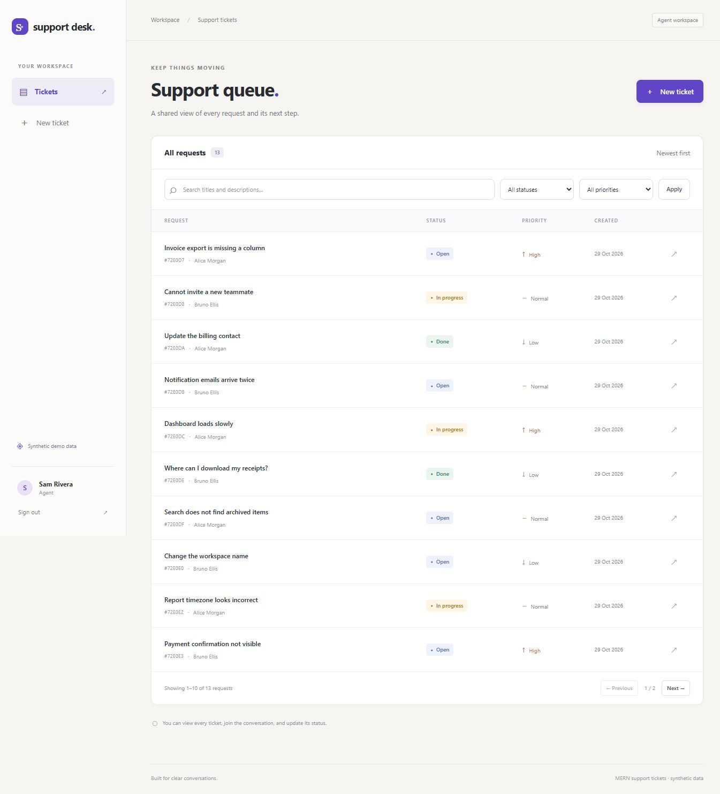
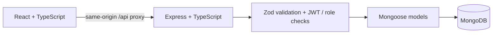

# MERN Support Tickets

[](https://github.com/hamza2829/mern-support-tickets/actions/workflows/ci.yml)

A small support-ticket workspace built with **MongoDB, Express, React and Node.js**, with TypeScript on both sides. Customers create requests and talk to support; agents work through the shared queue. All included accounts, ticket text and comments are **synthetic**. This is a working local portfolio project, not a deployed customer-support service.



## What it does

- JWT login with customer and agent roles, bcrypt password hashes, and one-hour access tokens.
- Create a ticket with a title, description and low/normal/high priority.
- Filter by status and priority, search literal text in titles/descriptions, and paginate results.
- Open a ticket and add comments with server-assigned authors. Comments have their own pagination.
- Agents change status between **open**, **in progress**, and **done**, including reopening a ticket.
- Clear validation/errors, accessible form labels, loading/empty/error states, and a responsive interface.
- REST API with an [OpenAPI description](backend/openapi.json), also served at `/api/openapi.json`.

| Permission                                    | Customer         | Agent       |
| --------------------------------------------- | ---------------- | ----------- |
| Create a ticket owned by themselves           | Yes              | Yes         |
| List, search and read tickets                 | Own only         | All         |
| Read/post comments                            | Own tickets only | All tickets |
| Change status                                 | No               | Yes         |
| Choose another owner or assign a role via API | No               | No          |

The API enforces these rules independently of the UI. Other customers' ticket IDs return the same 404 as nonexistent IDs. There is no public registration or admin/role-management endpoint.

## Run on Windows without Docker

Use **Node.js 22.12+ within the 22.x line** and npm. The project was checked locally with Node **22.19.0**. You do not need to install MongoDB for the temporary demo.

```powershell
git clone https://github.com/hamza2829/mern-support-tickets.git
cd mern-support-tickets
$env:MONGOMS_DISABLE_POSTINSTALL = "1"
npm ci
npm run demo
```

Wait for `API ready`, then open [http://127.0.0.1:5173](http://127.0.0.1:5173). The API listens on [http://127.0.0.1:4000](http://127.0.0.1:4000). The frontend proxies `/api` to the backend; no frontend secret or API key is needed.

The first demo/test run downloads a **real MongoDB 8.2.6 binary** from MongoDB's download servers. The Windows archive observed during verification was about **781 MB**, so allow download/extraction time and disk space. Subsequent runs reuse `backend/.cache/mongodb/`. `MONGOMS_DISABLE_POSTINSTALL` delays that download until the database is actually needed; it does not skip tests or database use. Internet access is needed for npm installation and the first MongoDB download.

The demo creates a temporary database and a fresh random JWT secret. **Stopping it discards the demo data.** Stop both servers with Ctrl+C. This mode is for local development only; it does not provide persistent storage or a production MongoDB deployment.

| Demo account         | Role             | Password       |
| -------------------- | ---------------- | -------------- |
| `alice@example.test` | Customer         | `DemoPass123!` |
| `bruno@example.test` | Another customer | `DemoPass123!` |
| `agent@example.test` | Agent            | `DemoPass123!` |

These are deliberately public demo credentials. A fresh demo starts with **12 fictional tickets and 4 comments**. Alice and Bruno each own six tickets; the agent sees all twelve. The screenshot shows thirteen because the browser smoke check created one additional request. IDs are generated by MongoDB; the sample content is fixed.

## Use a persistent MongoDB database instead

Use a locally installed MongoDB instance or your own MongoDB Atlas development database. No Docker is required for either option. Run the seed only against a dedicated development database.

```powershell
Copy-Item backend/.env.example backend/.env
node -e "console.log(require('node:crypto').randomBytes(32).toString('hex'))"
```

Edit `backend/.env`: set `JWT_SECRET` to the generated value and `MONGO_URI` to your database URI. The example JWT secret is intentionally empty; startup rejects missing/short values. Keep `.env` out of Git.

```powershell
npm run seed -w backend
npm run dev
```

The seed inserts missing synthetic accounts without resetting existing passwords. It adds the twelve sample tickets only when the ticket collection is empty; it never deletes existing data. Without demo mode or a seed, there are no accounts to log in with.

## Tests and builds

From the repo root:

```powershell
npm test
npm run build
```

Or run each part separately:

```powershell
npm run test -w backend
npm run test -w frontend
npm run build -w backend
npm run build -w frontend
```

**Local result: 64 API tests + 10 component tests passed; both builds passed.** CI runs the API tests/build and frontend tests/build as separate jobs on Ubuntu 24.04 with Node 22, using `npm ci` and the committed lockfile. It starts MongoDB through mongodb-memory-server, with no Docker or external database service. See [the workflow](.github/workflows/ci.yml) and [verification evidence](docs/VERIFICATION.md).

| Checks                                        | What is actually exercised                                                                                                                                                                                                                                                                                  |
| --------------------------------------------- | ----------------------------------------------------------------------------------------------------------------------------------------------------------------------------------------------------------------------------------------------------------------------------------------------------------- |
| **64 Jest + Supertest API tests**             | Real Express requests and Mongoose operations against a temporary MongoDB process: login/JWT validation, role and ownership boundaries, ticket creation/list/detail, combined filters, literal search, pagination, comments, status changes, invalid/mass-assigned inputs, body limits and error responses. |
| **10 Vitest tests across 3 React components** | LoginForm, TicketForm and TicketFilters: validation, submit values, filter clearing/synchronization, pending login state, and displayed failures. Callbacks are mocked; these are jsdom component tests, not full-browser integration tests.                                                                |
| **Builds**                                    | Backend TypeScript compilation and frontend TypeScript checking plus a Vite production bundle.                                                                                                                                                                                                              |
| **Browser smoke check**                       | Local customer login, filters, ticket creation, comment posting, agent login, queue pagination and status change; mobile and desktop layouts inspected. This was performed through browser automation during development, not saved as an automated E2E test suite.                                         |

The Jest setup supplies an explicit OS runtime adapter because the current MongoDB Node driver has a [documented Jest VM issue](https://jira.mongodb.org/browse/NODE-7832). This is a connection compatibility workaround, not a database mock. Test fixtures use bcrypt cost 4 to keep tests fast; the demo seed uses cost 10.

Production build outputs are `backend/dist/` and `frontend/dist/`. With a configured persistent database, run `npm start -w backend`. For a local built-frontend check, run `npm run preview -w frontend` in another terminal and visit port 4173. A real deployment would need a static host/reverse proxy that sends `/api` to Express and returns `index.html` for React routes; no deployment has been performed here.

## API at a glance

Base URL: `http://127.0.0.1:4000/api`. Protected requests use `Authorization: Bearer <token>`.

| Method / path                | Purpose                                             |
| ---------------------------- | --------------------------------------------------- |
| `GET /health`                | Public database readiness                           |
| `GET /openapi.json`          | Public OpenAPI document                             |
| `POST /auth/login`           | Email/password login; token and public user profile |
| `GET /auth/me`               | Current account and current database role           |
| `GET /tickets`               | Scoped, filtered, paginated list                    |
| `POST /tickets`              | New open ticket owned by the signed-in user         |
| `GET /tickets/:id`           | Accessible ticket detail                            |
| `PATCH /tickets/:id/status`  | Agent-only status update                            |
| `GET /tickets/:id/comments`  | Scoped, paginated comments                          |
| `POST /tickets/:id/comments` | Post a comment as the signed-in user                |

Example list: `/tickets?status=in%20progress&priority=high&q=export&page=1&limit=10`. Search is case-insensitive **literal substring** matching, not a regular expression. List filters combine with AND. Both lists default to page 1 / limit 10, maximum limit 50 and page 10,000. Newest records come first, with ID as a tie breaker.

Example create body:

```json
{
  "title": "Export is missing a column",
  "description": "The October test export does not include the reference column.",
  "priority": "high"
}
```

Validation errors use a consistent structure:

```json
{
  "error": {
    "code": "VALIDATION_ERROR",
    "message": "Please check the submitted fields.",
    "details": [{ "field": "title", "message": "..." }]
  }
}
```

Zod trims and bounds fields, rejects unknown body/query keys and validates enums/IDs. The server builds its own MongoDB filters and escapes search regex characters. It never passes an arbitrary request body into a database update. JWT verification restricts algorithm, issuer, audience and expiry; the current role is read from the database. Responses explicitly serialize public fields, excluding password hashes. Helmet supplies security headers; login is limited to 20 attempts per IP per five-minute window. JSON bodies are limited to 32 KB.

## How the pieces fit



```text
backend/src/app.ts          Express routes, filters and response handling
backend/src/auth.ts         JWT verification and current user/role lookup
backend/src/models.ts       User, Ticket, Comment schemas and public serializers
backend/src/seed-data.ts    Fixed synthetic accounts/tickets
backend/src/demo.ts         Temporary database + synthetic demo startup
backend/openapi.json        REST API contract
backend/tests/             Jest / Supertest / real temporary MongoDB tests
frontend/src/App.tsx        Routes, layout, ticket list/detail and page logic
frontend/src/auth.tsx       Memory-only session and authenticated request helper
frontend/src/components/   Forms, filters, badges and three component test suites
.github/workflows/ci.yml    Independent backend and frontend test/build jobs
```

Users have many tickets; tickets have many comments; a comment references its author. Comments live in a separate collection rather than an unbounded array on each ticket. The app uses ordinary React state/hooks and a small fetch wrapper, with no Redux, background jobs or messaging infrastructure.

## Honest limits

- All sample data is synthetic. No real customer records or production company data are supplied.
- Tests and builds were executed by Codex. They do not mean the user has personally tested the app or that it has an independent security audit.
- No automated browser E2E suite, load tests, production/Atlas integration run, deployment, backups, email integration or accessibility audit is claimed. The browser check is one recorded local workflow.
- Tokens are held only in React memory; reloading signs you out. There are no refresh tokens, password reset, registration, MFA or server-side token revocation. Signing out clears the browser session; a copied token remains valid until expiry unless its account is removed.
- Status updates use last-write-wins. There is no assignment workflow, attachment upload, delete/edit UI, real-time chat or optimistic concurrency control.
- Search is a small-dataset substring query, not an indexed full-text engine. Offset pagination can shift if other users insert records while browsing.
- The rate limiter is in one server process. A production service would need appropriate TLS, secrets management, deployment/proxy settings, abuse controls and shared rate-limit storage.
- The full npm audit currently reports low-severity development findings through Jest's `deepmerge` dependency; see [verification notes](docs/VERIFICATION.md). No claim of a completely clean dependency audit is made.

## If something does not start

Check `node --version` (use Node 22.12+), wait for the first MongoDB download, and ensure ports 4000/5173 are free. Do not run `npm run demo` and `npm run dev` at the same time. A proxy error usually means the API is not ready yet. For persistent mode, check `backend/.env`, the MongoDB connection and a fresh JWT secret. Demo data is intentionally lost after shutdown; use persistent mode to keep your tickets.
